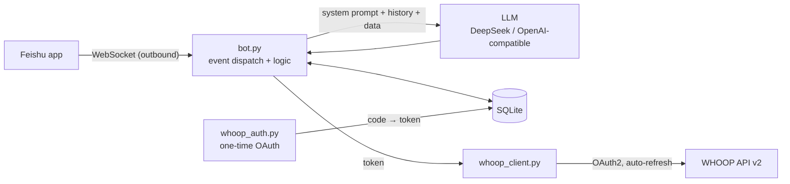

# Fitness Agent · WHOOP × Feishu (Lark)

> A personal fitness coach agent running on a small Alibaba Cloud ECS instance.
> It pulls WHOOP recovery / sleep / workout data, coaches you with an LLM, and lives
> inside Feishu — logging your workouts from plain language and producing monthly reviews.

This is not another chat-bot demo: it is a system that has been running in production every day.
The full Chinese write-up is in [README.md](README.md); this page is a condensed English overview.

## What makes it interesting

- **Feishu WebSocket long connection** — no inbound ports, no domain, no TLS certificate needed.
- **Authorize WHOOP once, refresh forever** — the access token (~1h) is renewed automatically
  before it expires; rotated refresh tokens are written atomically (mode 600) and guarded by a
  lock, so concurrent message handlers cannot clobber each other. No re-login afterwards.
- **Natural-language workout logging** — "did chest tonight, bench 60kg 4x8" is parsed,
  matched against WHOOP workout records, confirmed by you, then persisted to SQLite.
- **Grounded prompting** — explicit rules forbid inventing weights, age, or recovery scores;
  WHOOP observation vs. model speculation are kept apart.
- **Runs on 2 vCPU / 1.7 GB RAM** — hard-capped at 512 MiB / 0.5 vCPU per container.


<p align="center"><i>One <code>/whoop</code> in Feishu: recovery, 30-day baseline, sleep stages, latest workout, body metrics</i></p>

<p align="center"><sub>Screenshot taken from the live deployment, keeping the API's raw precision (skin temp 33.8266668°C); the released code rounds these values to one decimal, so yours will read 33.8°C.</sub></p>

## Architecture



## Quick start

```bash
git clone https://github.com/ONELEIJE/whoop-fitness-agent.git
cd whoop-fitness-agent
cp .env.example .env                     # Feishu + LLM + WHOOP credentials
cp examples/profile.example.json app/data/profile.json

bash scripts/whoop_login.sh              # one-time WHOOP authorization (cloudflared tunnel)
python scripts/whoop_dump.py             # verify the WHOOP data path

docker compose up -d --build
```

Send `/whoop` to the bot in Feishu to verify the whole chain.

## Commands

| Command | Purpose |
| --- | --- |
| `/status` | liveness |
| `/help` | command list |
| `/whoop` | WHOOP dashboard card |
| `/月报` `/月报 2026-09` | monthly review (current / given month) |

## Docs

| Doc | Content |
| --- | --- |
| [01-architecture.md](docs/01-architecture.md) | modules, data flow, database schema, HTTP API, trade-offs |
| [02-ecs-deploy.md](docs/02-ecs-deploy.md) | ECS sizing, security group, Docker, swap, upgrade, backup |
| [03-whoop-oauth.md](docs/03-whoop-oauth.md) | WHOOP developer app, OAuth flow, token rotation, 401/429 troubleshooting |
| [04-feishu-bot.md](docs/04-feishu-bot.md) | Feishu app setup, scopes, long connection, cards |
| [05-agent-design.md](docs/05-agent-design.md) | prompt rules, NL parser, WHOOP matcher, state machine |
| [06-operations.md](docs/06-operations.md) | day-2 operations, backup, failure table, security checklist |

## Notes / limitations

- `bot.py` is a ~3.1k-line single module inherited from the production deployment; splitting it
  into packages is the main refactor left on the roadmap.
- Container runs as root (unchanged from production). Making it non-root requires fixing ownership
  of `app/data`.
- Text messages only; single-user design.

## License

[MIT](LICENSE)
