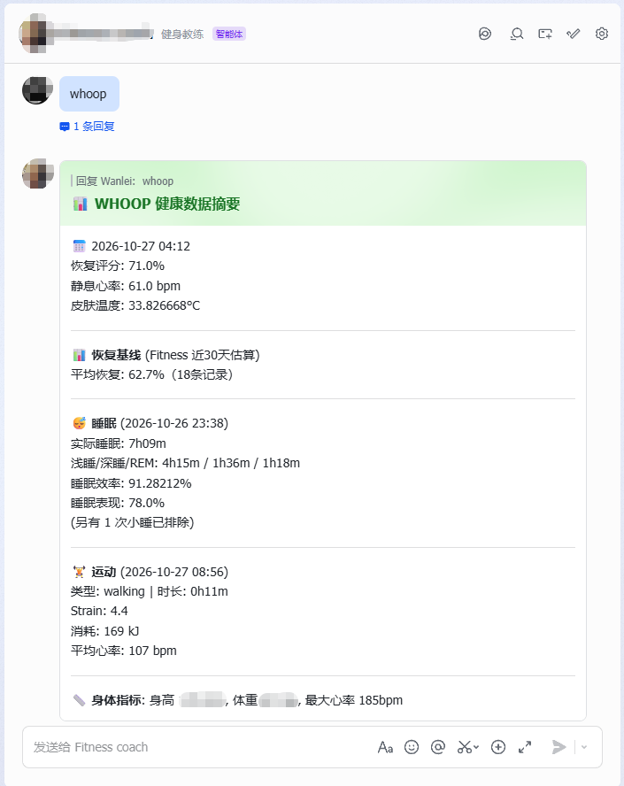
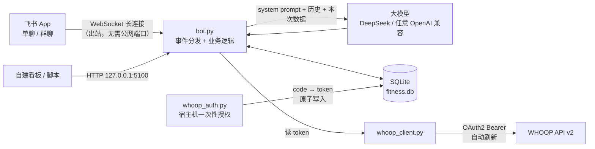

# Fitness Agent · WHOOP × 飞书

**中文** | [English](README.en.md)

[](https://github.com/ONELEIJE/whoop-fitness-agent/actions/workflows/ci.yml)


> 一个跑在阿里云 ECS 上的个人健身教练 Agent：把 WHOOP 手环的恢复 / 睡眠 / 运动数据接进来，
> 用大模型给出有依据的训练建议，日常在飞书里对话、自动记录训练、月底出总结。

**30 秒验证它真的能跑**（不需要任何密钥、不联网）：

```bash
git clone https://github.com/ONELEIJE/whoop-fitness-agent.git && cd whoop-fitness-agent
python -m venv .venv && source .venv/bin/activate   # Windows: .venv\Scripts\activate
pip install -r requirements.txt
python scripts/selftest.py        # 42 项离线检查：建表 / 提示词 / 解析器 / HTTP 通道 / 卡片
```

它不是又一个「聊天机器人 demo」。这是一套**真的在线上每天跑**的系统，从服务器、权限、
令牌刷新到数据落库、幂等去重、失败兜底，都按生产环境的方式写：

- **飞书 WebSocket 长连接**收消息 —— 服务器不用开放任何入站端口，不用备案域名，不用 HTTPS 证书
- **WHOOP 授权一次，之后永久自动续期** —— access token 每小时自动换新，refresh token 轮换后原子落盘 + 并发加锁，不用再手动登录
- **自然语言记训练** —— 「今天练了胸，卧推 60kg 4 组 8 次」→ 解析 → 匹配 WHOOP 运动记录 → 落库
- **一切有据可查** —— 提示词里明确区分「观测数据 / 模型推测」，禁止编造重量、年龄、恢复分
- **小内存可用** —— 2 核 1.7G 的入门 ECS 上限制 512MiB / 0.5 核跑得稳稳的



<p align="center"><i>在飞书里发一次 <code>/whoop</code> 拿到的卡片：恢复、30 天恢复基线、睡眠分期、最近运动、身体指标</i></p>

<p align="center"><sub>截图为线上真实数据，保留接口返回的原始精度（皮肤温度 33.8266668°C）；开源版对这些数值统一保留一位小数，你跑出来的会是 33.8°C。</sub></p>

---

## 目录

- [它能做什么](#它能做什么)
- [架构](#架构)
- [快速开始](#快速开始)
- [四种用法](#四种用法)
- [部署到 ECS](#部署到-ecs)
- [目录结构](#目录结构)
- [配置项](#配置项)
- [常见问题](#常见问题)
- [安全与隐私](#安全与隐私)
- [文档索引](#文档索引)
- [适合谁 / 不适合谁](#适合谁--不适合谁)
- [已知不足](#已知不足)
- [License](#license)

---

## 它能做什么

| 能力 | 说明 |
| --- | --- |
| 健身问答 | 只回答训练 / 营养 / 恢复 / 体态相关，闲聊会被礼貌挡回去 |
| WHOOP 数据 | `/whoop` 输出恢复分、HRV、静息心率、睡眠分期、周期、最近一次运动、身体指标 |
| 训练计划 | 返回结构化卡片（动作 / 组数 / 次数 / RPE / 休息），缺少个人重量数据时**不编造**，改为反问 |
| 自然语言记训练 | 说一句「昨晚打了 1 小时篮球」就自动解析日期、项目、时长，并尝试关联 WHOOP 运动记录 |
| 月度总结 | `/月报` 或 `/月报 2026-09`，把 WHOOP 月度趋势和本地训练记录合成一张卡 |
| 对话记忆 | 每个「群 + 人」保留最近 10 轮对话（上限约 24k 字符） |
| 消息幂等 | 飞书事件会重投，靠 `message_state` 表原子抢锁，同一条消息只处理一次 |

实际对话大概是这样：

```text
你：今天状态怎么样，适合练什么？
Bot：（自动带本次 WHOOP 数据）已获取 WHOOP 数据：2026-10-28 恢复 62%、HRV 68ms、
     静息心率 52bpm、睡眠 7h12m（深睡 1h05m）。今天建议中等强度推日…

你：晚上练了胸，卧推 60kg 4x8，上斜哑铃 22.5kg 4x10
Bot：✅ 训练已记录
     📅 2026-10-28 · 力量训练 · 约 55 分钟
     🏋️ 卧推 4×8 60kg / 上斜哑铃卧推 4×10 22.5kg
     📱 WHOOP: 已关联「Weightlifting」Strain 11.2 · 最高心率 148bpm
```

## 架构



四个阶段对应四篇文档：

1. **部署**：ECS + Docker Compose，2 核 2G 起步 → [docs/02-ecs-deploy.md](docs/02-ecs-deploy.md)
2. **读 WHOOP**：开发者应用 + OAuth 授权 + 自动续期 → [docs/03-whoop-oauth.md](docs/03-whoop-oauth.md)
3. **健身 Agent**：提示词设计、自然语言解析、WHOOP 匹配、状态机 → [docs/05-agent-design.md](docs/05-agent-design.md)
4. **飞书交互**：自建应用、长连接、权限、卡片 → [docs/04-feishu-bot.md](docs/04-feishu-bot.md)

关键技术选择的原因（为什么长连接而不是 Webhook、为什么 SQLite、为什么单容器）写在
[docs/01-architecture.md](docs/01-architecture.md)。

## 快速开始

前置：Python 3.11+、Docker（可选，本地直接跑也可以）、一个 WHOOP 账号、一个飞书企业自建应用。

### 第 0 步：不填任何密钥，先确认代码能跑

```bash
pip install -r requirements.txt
python scripts/selftest.py
```

输出 `结果：42 通过 / 0 失败` 就说明环境没问题。这一步不需要飞书、不需要 WHOOP、不需要 API Key，
CI 里跑的也是它。

### 第 1 步：填配置

```bash
git clone https://github.com/ONELEIJE/whoop-fitness-agent.git
cd whoop-fitness-agent

cp .env.example .env
#   填 FEISHU_APP_ID / FEISHU_APP_SECRET
#   填 DEEPSEEK_API_KEY
#   填 WHOOP_CLIENT_ID / WHOOP_CLIENT_SECRET

cp examples/profile.example.json app/data/profile.json
#   改成你自己的年龄、身高、体重、目标、每周频率……
```

### 第 2 步：打通 WHOOP（可跳过）

```bash
bash scripts/whoop_login.sh        # 按屏幕提示完成一次 OAuth
python scripts/whoop_dump.py       # 能打印出恢复/睡眠/运动，就说明数据链路通了
```

### 第 3 步：起机器人

```bash
docker compose up -d --build
docker compose logs -f
```

然后在飞书里给这个应用发一条「/whoop」，收到卡片就说明整条链路通了。

> 只想先跑通飞书和模型、暂时不接 WHOOP 也可以：`/whoop` 会提示获取失败，其余对话功能正常。

## 四种用法

### 1. 命令

| 命令 | 作用 |
| --- | --- |
| `/status` | 存活检查 |
| `/help` | 命令列表 |
| `/whoop` | WHOOP 数据卡（恢复 / 睡眠 / 周期 / 运动 / 身体指标） |
| `/月报` | 本月训练 + WHOOP 趋势总结 |
| `/月报 2026-09` | 指定月份 |

### 2. 自然语言记训练

不需要记命令，正常说话就行。识别后会走一遍「确认」：

```text
你：昨天下午跑了 5 公里，配速 5'40"
Bot：📝 识别到训练：2026-10-27 · 跑步 · 30 分钟
     找到 1 条 WHOOP 运动记录与之匹配。回复「确认」保存，或「取消」。
你：确认
Bot：✅ 已保存
```

- 有歧义（同一天多条候选）会列出编号让你选 `1` / `2` / `3`
- 待确认状态 10 分钟过期，不会一直挂着
- 解析和匹配都是**确定性代码**，大模型不参与「存不存、存哪条」的判断

### 3. 训练计划卡片

要计划时会返回结构化卡片。提示词强制：没有历史重量数据时 `weight` 必须为 `null`，
并反问你的工作重量，而不是瞎填一个数字。

### 4. HTTP 通道（可选）

同一套业务逻辑还能从 HTTP 调，方便接自己的看板、iOS 快捷指令、定时任务：

```bash
curl -s localhost:5100/health
curl -s -X POST localhost:5100/internal/chat \
  -H 'Content-Type: application/json' \
  -d '{"message":"今天适合练什么","session_id":"web-1"}'
```

默认只绑 `127.0.0.1`，不对外暴露。接口说明见 [docs/01-architecture.md](docs/01-architecture.md#http-通道)。

## 部署到 ECS

最省事的路径（Ubuntu 22.04 / 24.04）：

```bash
# 1. 装 Docker + 加 swap + 起服务（脚本会自己判断内存）
sudo bash scripts/install_ecs.sh

# 2. 看状态
docker compose ps
curl -s localhost:5100/health
```

几个真实踩过的点，都写在 [docs/02-ecs-deploy.md](docs/02-ecs-deploy.md) 里：

- **安全组只开 SSH 就够**。飞书走 WebSocket 出站连接，不需要 80/443，也不需要域名和证书
- **2G 内存一定要加 swap**，`pip install` 和镜像构建会有瞬时峰值
- **别用 `docker run`**，统一 `docker compose`，否则重启策略、挂载、资源限制都会丢

## 目录结构

```text
whoop-fitness-agent/
├── app/
│   ├── bot.py              # 飞书事件分发 + 业务逻辑 + HTTP 通道（约 3100 行，一个文件到底）
│   ├── whoop_client.py     # WHOOP API v2 客户端：分页、重试、令牌自动刷新
│   ├── whoop_auth.py       # 一次性 OAuth 授权小工具（跑在宿主机/本地）
│   └── data/               # 运行时数据：fitness.db / profile.json / whoop_token.json（不入库）
├── scripts/
│   ├── whoop_login.sh      # 起隧道 + 授权服务，拿 token
│   ├── whoop_dump.py       # WHOOP 自检 / 导出 JSON / 同步运动到 SQLite
│   └── install_ecs.sh      # ECS 一键准备与启动
├── deploy/
│   └── whoop-auth.service  # 可选：把授权小工具做成 systemd 常驻服务
├── docs/                   # 四篇主文档 + 架构 + 运维
├── examples/
│   └── profile.example.json
├── Dockerfile
├── docker-compose.yml
└── .env.example
```

## 配置项

| 变量 | 必填 | 说明 |
| --- | --- | --- |
| `FEISHU_APP_ID` | ✅ | 飞书自建应用 App ID |
| `FEISHU_APP_SECRET` | ✅ | 飞书自建应用 App Secret |
| `DEEPSEEK_API_KEY` | ✅ | 模型 API Key |
| `DEEPSEEK_BASE_URL` | 默认 `https://api.deepseek.com` | 任意 OpenAI 兼容地址 |
| `DEEPSEEK_MODEL` | 默认 `deepseek-chat` | 模型名 |
| `WHOOP_CLIENT_ID` | 接 WHOOP 时必填 | WHOOP 开发者应用 |
| `WHOOP_CLIENT_SECRET` | 接 WHOOP 时必填 | 同上 |
| `FITNESS_DB_PATH` | 默认 `/app/data/fitness.db` | SQLite 路径 |
| `FITNESS_PROFILE_PATH` | 默认 `/app/data/profile.json` | 个人档案 JSON |
| `WHOOP_TOKEN_PATH` | 默认 `/app/data/whoop_token.json` | 令牌文件 |

## 常见问题

### WHOOP 只要填好 Client ID / Secret 就能用了吗？

**还差一步：OAuth 授权。** WHOOP 走标准授权码流程，必须由你本人在浏览器里点一次「同意」，
应用才能拿到 refresh_token。这一步只做一次（`bash scripts/whoop_login.sh`，约 2 分钟），
之后不需要再登录。所以准确的说法是：**一次性授权 + 之后全自动**，而不是「填完密钥就开箱即用」。

### Token 会过期吗？要不要每天重新授权？

不用。令牌分两层，全部自动处理：

| 令牌 | 有效期 | 谁负责续期 |
| --- | --- | --- |
| `access_token` | 约 1 小时 | `whoop_client.py` 在过期前 60 秒自动用 refresh_token 换新的 |
| `refresh_token` | 每次刷新都会轮换出新值 | 换新后**原子写回** `whoop_token.json`（临时文件 + `rename` + `chmod 600`） |

刷新过程带进程锁：飞书是并发处理消息的，两个线程同时刷新会互相把对方的 refresh_token 刷废，
所以代码里是「拿锁 → 重新读一次文件 → 仍然过期才刷」。

只有三种情况需要重新授权：令牌文件被删或丢失、你在 WHOOP 后台撤销了授权、换了 client_secret。

### 我的数据会被传到哪里？

WHOOP 原始响应、训练明细、对话历史只写本地 SQLite（`app/data/fitness.db`）。
发给模型服务商的只有：本次问题 + 最近 10 轮对话 + 本次 WHOOP 摘要 + 你的档案。
不能接受的话，把 `DEEPSEEK_BASE_URL` 指向自建模型网关即可。

### 能换成别的模型吗？

可以。任何 OpenAI 兼容接口都行，改 `DEEPSEEK_API_KEY` / `DEEPSEEK_BASE_URL` / `DEEPSEEK_MODEL` 三个变量。

### 支持多用户吗？

当前是单人单库设计。多人使用要把 `scope` 与档案做成多租户，属于 roadmap（见「已知不足」）。

## 安全与隐私

- 密钥只放 `.env`（已 `.gitignore`），仓库里只有 `.env.example` 占位符
- 令牌文件 `chmod 600`、原子写；日志里不打印 token / code / secret
- 数据库、WHOOP token、个人档案全在 `app/data/`，容器重建不丢，也不会被提交
- HTTP 通道默认只绑回环地址
- 容器限制 512MiB 内存 / 0.5 核，日志轮转，不加 `privileged`，不挂 `docker.sock`
- 你的身体数据属于你自己：只存在本地 SQLite，只有被选中做推理的那部分会发给模型服务商

## 文档索引

| 文档 | 内容 |
| --- | --- |
| [01-architecture.md](docs/01-architecture.md) | 模块职责、数据流、数据库表、HTTP 接口、关键取舍 |
| [02-ecs-deploy.md](docs/02-ecs-deploy.md) | 阿里云 ECS 选型到上线：安全组、Docker、swap、升级、备份 |
| [03-whoop-oauth.md](docs/03-whoop-oauth.md) | WHOOP 开发者应用、OAuth 授权、令牌轮换、429 / 401 排障 |
| [04-feishu-bot.md](docs/04-feishu-bot.md) | 飞书应用创建、权限、长连接、卡片、发布 |
| [05-agent-design.md](docs/05-agent-design.md) | 提示词规则、NL 解析、WHOOP 匹配、状态机、记忆与幂等 |
| [06-operations.md](docs/06-operations.md) | 日常运维、备份、升级、故障速查、安全清单 |

## 适合谁 / 不适合谁

**适合：**

- 戴 WHOOP，想知道「今天该练多少」而不是只看一个恢复分的人
- 在飞书办公、不想再装一个 App 的人
- 想要一套「自己完全掌控数据」的方案，而不是把健康数据交给第三方 SaaS
- 想学「个人 Agent 怎么上生产」的开发者：这里有钱包不厚时的完整做法——长连接省掉域名/证书、
  令牌自动续期、幂等去重、失败兜底、SQLite 单文件备份

**不适合：**

- 想要开箱即用的 App：这里要自己申请飞书应用和 WHOOP 开发者应用（各 10 分钟）
- 想要多用户 / 团队版：当前是单人单库设计
- 完全不想写代码、不碰命令行：部署至少需要会 SSH 和编辑 `.env`

## 已知不足

坦白写清楚，免得你踩同样的坑：

- `bot.py` 是从线上单文件演化来的，3100 行偏长，理想状态该拆成 `coach/`、`logging/`、`feishu/`、`http/` 四个模块（欢迎 PR）
- 容器以 root 运行（沿用线上配置），改成非 root 需要同步处理 `app/data` 的属主
- 只支持文本消息，语音/图片没有做
- 单用户设计：多用户需要把 `scope` 与档案做成多租户
- 测试只有 `scripts/selftest.py`（42 项离线检查），没有覆盖 WHOOP / 飞书真实 API 的集成测试——
  那两个接口需要真账号，只能用 `scripts/whoop_dump.py` 手工验证

## License

[MIT](LICENSE) · Copyright (c) 2026 wanlei

如果这套流程帮你少踩几个坑，给个 Star 就好 ⭐
