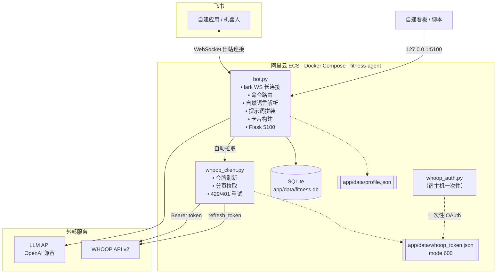

# 架构与设计取舍

## 一张图看懂



## 模块职责

| 模块 | 职责 | 刻意不做的事 |
| --- | --- | --- |
| `bot.py` | 事件分发、命令路由、自然语言解析、提示词、卡片、SQLite、HTTP 通道 | 不直接调 WHOOP HTTP，不解析 OAuth |
| `whoop_client.py` | WHOOP API v2 封装、令牌自动续期、分页、限流重试 | 不管飞书，不管业务语义 |
| `whoop_auth.py` | 一次性 OAuth：state 校验、code 换 token、原子落盘 | 不常驻、不依赖数据库 |
| `scripts/whoop_dump.py` | 不启动 Bot 也能自检数据链路 | 不写业务数据 |

## 一条消息的生命周期

以飞书里发「晚上练了胸，卧推 60kg 4x8」为例：

1. **接收**：飞书通过已经建好的 WebSocket 推 `im.message.receive_v1` 事件。
2. **去重**：`try_claim_message(message_id)` 往 `message_state` 插一行，
   主键冲突直接丢弃（飞书会重投事件）。
3. **串行化**：同一个 `scope`（群 + 人的哈希）加互斥锁，避免同一个人连发两条消息时状态打架。
4. **拦截待确认态**：如果上一条消息留下了「待确认 / 待选择」，先看这句是不是 `确认` `取消` `1`。
5. **判断意图**：
   - 命中命令（`/whoop`、`/月报`）→ 直接构造卡片
   - 命中「已完成训练」的语气 → 走自然语言解析
   - 其余 → 走大模型对话
6. **拼提示词**：`build_system_prompt(profile)` + 本次 WHOOP 数据（成功/失败两套文案） + 最近 10 轮历史。
7. **调模型**：`deepseek_client.chat.completions.create`，`max_tokens=1024`。
8. **落库**：训练记录写 `training_logs`；对话写 `conversation_turns`（每 scope 保留 10 轮）。
9. **回复**：文本或交互卡片；成功 `mark_sent`，失败 `mark_failed`。

## 数据库

单个 SQLite 文件，WAL 模式。`app/bot.py` 里的 `_ensure_schema()` 会幂等建表，
并给旧库补列——这样空数据库也能直接跑起来。

| 表 | 用途 | 关键列 |
| --- | --- | --- |
| `message_state` | 消息幂等 | `message_id` 主键、`status`、`reply_sent` |
| `training_logs` | 训练记录 | `scope`、`training_date`、`exercises`(JSON)、`activity_type`、`duration_minutes`、`intensity`、`whoop_matched`、`whoop_workout_id` |
| `conversation_turns` | 对话记忆 | `scope`、`message_id` 唯一、`user_text`、`assistant_text` |
| `pending_actions` | HTTP 通道的待确认动作 | `confirmation_id` 主键、`channel`、`session_id`、`status`、`expires_at` |
| `whoop_workouts` | WHOOP 运动会话落地 | `workout_id` 主键、`sport_name`、`start_cst`、`strain`、`average_heart_rate` |

索引：`training_logs(training_date)`、`conversation_turns(scope, id)`。

> 为什么不用 PostgreSQL？个人使用、单机、数据量以千行计，SQLite 省掉一个容器和大半内存，
> 备份就是 `cp` 一个文件。真要多用户/多实例再接 PG 不迟。

## HTTP 通道

`bot.py` 用 Flask 在容器内 `0.0.0.0:5100` 起一个内部服务，compose 只把它绑到宿主机回环。

| 接口 | 方法 | 说明 |
| --- | --- | --- |
| `/health` | GET | `{"status":"ok","database":"connected","service":"fitness-agent"}` |
| `/internal/chat` | POST | 入参 `{"message","session_id"}`，返回 `{"type","content",...}` |
| `/internal/confirm` | POST | 入参 `{"confirmation_id","session_id","action":"confirm\|cancel\|select","choice"?}` |

`/internal/chat` 的 `type` 可能是 `text`、`card`、`confirm_pending`、`select_pending`、`error`。
当返回 `confirm_pending` / `select_pending` 时，前端拿 `confirmation_id` 调 `/internal/confirm`，
状态落 `pending_actions` 表，10 分钟过期。

## 关键取舍

### 为什么用 WebSocket 长连接，而不是 Webhook

飞书自建应用两种收消息方式：Webhook 要公网可达的 HTTPS 地址（域名 + 证书 + 备案 + 安全组开放端口），
长连接只要出站 443。对「一台 ECS、没有域名」的个人项目，长连接的运维成本几乎为零：

- 不用暴露入站端口，攻击面小
- 不用管证书续期
- 容器重建后自动重连，`restart: unless-stopped` 就够

代价是：飞书侧必须选「使用长连接接收事件」，且一个应用同时只能有一个长连接进程（多副本会抢事件）。

### 为什么业务逻辑和 LLM 分工是「确定性的归代码，模糊的归模型」

解析日期、算时长、判断「这条 WHOOP 运动是不是这次训练」、决定落不落库——这些都用纯代码完成：

- `_parse_natural_language_log()`：正则抽日期、时间、动作、组次重量
- `_try_match_whoop_workout()`：按运动类型 + 时间窗 + 时长接近度打分
- `strain_to_intensity()`：Strain 分档 → 低/中等/中高/高/极高

模型只负责「说什么」，不负责「存什么」。这样即使模型抽风，训练记录也不会被污染。

### 为什么两套「待确认」状态

飞书通道用进程内字典（`_pending_confirms`），HTTP 通道用 `pending_actions` 表。
听起来不一致，其实是刻意的：

- 飞书是「一个人对着一个进程」，进程内的 10 分钟 TTL 足够，省一次 DB 往返
- HTTP 通道可能被多个前端（看板、快捷指令）并发调用，且需要跨请求持久化，必须落库

这是历史演进的痕迹，也是本项目已知的技术债之一（详见 README「已知不足」）。

### 失败怎么兜底

| 场景 | 行为 |
| --- | --- |
| WHOOP 拉取失败 | 提示词里明确写「获取失败 + 时间 + 原因」，禁止模型冒充成功 |
| 模型调用失败 | 回一句「AI 调用暂时不可用」，`mark_failed` 记录 |
| 会话被撤销 / 卡片发不出去 | 打日志，不影响后续消息处理 |
| 401 | 强制刷新一次令牌再重试（哪怕本地还没过期） |
| 429 | 按 `Retry-After` 等待，最多 3 次，封顶 120 秒 |
| 数据库写失败 | 明确回「保存失败」并列出尝试保存的字段，不假装成功 |

## 代码地图

```text
app/bot.py
├─ 1   ~   220   依赖、配置、日志、飞书客户端单例、命令帮助
├─ 220  ~  400   SQLite 建表/迁移、消息幂等
├─ 400  ~  900   对话记忆、待确认状态、训练日志读写
├─ 900  ~ 1150   自然语言解析（日期/时间/项目/动作/时长）
├─ 1150 ~ 1300   WHOOP 运动匹配、Strain → 强度
├─ 1300 ~ 1520   结果文案与确认信息
├─ 1520 ~ 2000   飞书消息处理主流程（命令 / 解析 / 模型 / 卡片）
├─ 2000 ~ 2620   卡片构建（WHOOP 卡、单卡、月报卡、多月卡）
├─ 2620 ~ 3100   通道无关的 process_fitness_request + Flask 接口
└─ 3100 ~ 3149   main()：启动 WS 与 HTTP 服务
```
